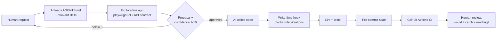

# Guide 4: Make It Presentable (README, LinkedIn and CV)

> Series: Building an Agentic Playwright Test Automation Framework
> Previous: [Guide 3: Point the framework at the booking app](03-point-it-at-the-booking-app.md)

## What you will do

1. Turn the repo into a **portfolio piece** a recruiter understands in 30 seconds.
2. Add an architecture diagram, CI badges and a short demo GIF.
3. Write a **LinkedIn post series** that links the project to your Workday integration and data experience.
4. Add **CV bullets** and a **profile section** that position you beyond "QA Lead".

**Do this after Guide 3's PR is merged**, so every claim points to real, green work.

> **Honesty rule:** only claim what's in the repo and what you did. Reviewers click links. A small, true, working project beats a big claim every time.

---

## Part 1: The portfolio README

The scaffold's README is the framework author's product page. Your repo needs **your** story. Keep the original as `docs/FRAMEWORK.md` for reference, and write a new `README.md`:

```bash
git checkout main && git pull
git checkout -b docs/portfolio-readme
git mv README.md docs/FRAMEWORK.md
```

Then create `README.md` from this template. Replace everything in `<angle brackets>`.

````markdown
# Agentic Playwright Test Automation: Rulebook-Driven AI Testing


An AI-assisted test automation framework where **the AI writes the tests, a rulebook
constrains them, automated guards enforce the rules, and a human approves for value.**
Built with Playwright and TypeScript against
[Restful Booker Platform](https://automationintesting.online), with UI and API coverage.


## Why this project

AI coding assistants write tests quickly but inconsistently: XPath, hard waits, `any` types
and hardcoded secrets. This framework applies **governance** to AI output, the same way
enterprise integration programmes govern data: clear rules, automated validation and
human sign-off.

## How it works



| Layer         | What it does                                                                                                 |
| ------------- | ------------------------------------------------------------------------------------------------------------ |
| **Rules**     | `AGENTS.md` Constitution (MUST / SHOULD / WON'T) + 17 task-specific skills                                   |
| **Guards**    | Write-time hook (18 blocked patterns), ESLint, Husky pre-commit scan, CI                                     |
| **Framework** | Page Objects, fixture-based dependency injection, Zod contract schemas, Faker factories, auth setup projects |

## What is tested

| Area         | Tests                                                 | Type |
| ------------ | ----------------------------------------------------- | ---- |
| Admin login  | Smoke + data-driven negative cases                    | UI   |
| Contact form | Happy path with generated data + per-field validation | UI   |
| Rooms API    | Strict schema validation                              | API  |
| Auth API     | Token issue + rejection cases                         | API  |

<Update this table to match what you actually built.>

## Engineering decisions

- **Contract-first API testing:** strict Zod schemas (`z.strictObject`) fail on missing
  _and_ unexpected fields, which catches silent contract drift.
- **Explore before generate:** the AI must inspect the live page before writing a
  selector, so it can't invent locators.
- **Test data strategy:** generated data for happy paths, curated static sets for
  negative cases, and cleanup of data created on a shared environment.
- **Secrets:** credentials live only in local env files and GitHub Actions secrets.
- <Add one decision you made yourself in Guide 3, e.g. how you handled contact-form cleanup.>

## Run it

```bash
npm install && npx playwright install chromium
cp env/.env.example env/.env.dev   # fill in values
npm test                           # full suite (excludes @destructive)
npm run test:api                   # API only
npm run report                     # HTML report
```

## Learning guides

The step-by-step series I wrote while building this: [docs/](docs/README.md).

## Credits

Built on the open-source [agentic-playwright](https://github.com/idavidov13/agentic-playwright)
scaffold by Ivan Davidov (MIT). My work: <adapting it to the booking app, auth setup, page
objects, tests, schemas, CI secrets and the learning guides>.

## About me

<One line, e.g.> Integration and data quality lead with Workday HCM, Finance and Payroll
programme experience, focused on integration validation, data integrity and AI-assisted
quality engineering. [LinkedIn](<your LinkedIn URL>)
````

> **Why the Credits section matters:** it's honest, and it's a strength. Saying "I adopted an open-source framework and adapted it to a new system" is exactly what integration consultants do every day.

### 1.1 Check the diagram renders

GitHub renders `mermaid` code blocks automatically. Push your branch and look at the README on GitHub before merging.

### 1.2 Record the demo GIF (10 minutes)

A 20 to 30 second GIF is the single most persuasive thing on the page.

1. Use a screen recorder that exports GIFs: **ScreenToGif** (Windows), **Kap** (Mac) or **Peek** (Linux).
2. Record one short loop in Claude Code:
    - type a small request, for example _"Add a test that the rooms API returns at least one room with a name"_;
    - show the **Proposal with Confidence**;
    - type _"approved"_;
    - show the final **lint + tests green** report.
3. Speed it up 2× and crop it to the terminal. Keep it under 5 MB.
4. Save it as `docs/assets/demo.gif`.

Optional second image: a screenshot of the Playwright HTML report with Given / When / Then steps expanded, at `docs/assets/report.png`.

### 1.3 Repo polish (5 minutes)

On GitHub, on the repo's front page, click the ⚙️ next to **About**:

- **Description:** `AI-assisted Playwright + TypeScript test automation with rulebook governance, contract testing and CI`
- **Topics:** `playwright`, `typescript`, `test-automation`, `ai-testing`, `agentic-ai`, `api-testing`, `zod`, `github-actions`, `quality-engineering`
- **Pin** the repo on your GitHub profile (**your profile → Customize your pins**).

### 1.4 Commit and merge

```bash
npm run lint
git add README.md docs/
git commit -m "docs: portfolio README with architecture and demo"
git push -u origin docs/portfolio-readme
```

Open the PR, wait for green CI and merge.

---

## Part 2: The LinkedIn post series

### 2.1 The positioning idea

Don't post "I learnt Playwright". Post **the bridge**: the governance and validation discipline you use on Workday integrations, applied to AI-generated automation. That's distinctive, and it's relevant to the people you want to reach: Workday partners, system integrators and HRIS leaders, who are all working out how to use AI safely.

**Your angle in one line:** _"AI can generate tests and integrations quickly. The value is in the rules, validation and sign-off around it, which is what I do on Workday programmes."_

### 2.2 The four-post series (one a week)

Use the **Hook → Story → Insight → Proof → Question** structure. Keep each post under 1,300 characters, put the link **in the first comment** (LinkedIn shows posts with outbound links to fewer people), and use 3 to 5 hashtags.

---

**Post 1: The hook post (the problem)**

> I asked an AI assistant to write a login test.
>
> It ran. It passed. And it would have broken within a week: XPath selectors, a 5-second hard wait, a hardcoded password, and an `any` type hiding the response shape.
>
> It reminded me of something I've seen on Workday integration programmes: an output file that "looks right" in a test tenant, then fails Payroll reconciliation because nobody validated the contract.
>
> The problem isn't the generator. It's the missing rules around it.
>
> So I built a small framework where:
> ✅ the AI reads a rulebook before it writes anything
> ✅ a hook blocks forbidden patterns before a file is even saved
> ✅ every API response is checked against a strict schema
> ✅ a human approves the plan, and reviews whether the test would catch a real bug
>
> Over the next few weeks I'll share what I learnt.
>
> How is your team governing AI-generated code or configuration?
>
> #Workday #TestAutomation #AI #Playwright #DataQuality

---

**Post 2: The governance post (the confidence gate)**

> The most useful AI feature I've built in is one where the AI stops itself.
>
> Before writing any test, the agent has to produce a plan with a confidence score from 1 to 10. Below 5, it isn't allowed to continue. It must ask me for the missing input: the real field label, the API contract, the exact error message.
>
> It's the same principle as a Workday integration design sign-off: no build until the mapping, the source of truth and the edge cases are agreed.
>
> Result: no invented selectors, no guessed messages, no "TODO" placeholders in the code.
>
> AI speed + human approval gates = output you can actually trust in production.
>
> Where do you put the human sign-off in your AI-assisted delivery?
>
> #Workday #AIGovernance #QualityEngineering #Integration

---

**Post 3: The data post (contract testing, your home ground)**

> "Strict schema" might be the most underrated phrase in integration testing.
>
> In my framework every API response is validated against a schema that fails on missing fields **and** on unexpected extra ones.
>
> Why the extra ones? Because on HCM, Finance and Payroll integrations, the defects that hurt most are often silent: a new field nobody mapped, a cost centre that arrives empty, a format that changes downstream of a Workday update.
>
> Validation that only checks "status 200" misses all of that.
>
> Three habits I carry from Workday data validation into test automation:
> 1️⃣ Validate the contract, not just the response code
> 2️⃣ Generate unique test data so parallel runs don't collide
> 3️⃣ Clean up what you create in a shared environment
>
> What's the sneakiest integration defect you've caught?
>
> #WorkdayIntegrations #DataIntegrity #Payroll #APITesting

---

**Post 4: The proof post (the project)**

> A few weeks ago I set out to build an AI-assisted test automation framework with real governance. It's live.
>
> 🔹 Playwright + TypeScript, UI and API tests
> 🔹 A rulebook the AI follows, with hooks that block bad patterns
> 🔹 Strict contract schemas, generated test data, CI on every push
> 🔹 A human approval gate before any code is written
>
> I also wrote a four-part guide series as I went, for anyone who wants to try the approach.
>
> Biggest lesson: AI doesn't remove the need for integration and validation expertise. It makes it more valuable, because someone has to define what "correct" means.
>
> Repo and guides in the comments 👇
>
> I'm open to Workday Integration, Data and BAU support contract roles across the UK and Europe.
>
> #Workday #OpenToWork #ContractRoles #TestAutomation #AI

**First comment:** `Repo: https://github.com/chiragbpatel2000/agentic-playwright-framework-rulebook (guides are in /docs)`

### 2.3 Posting tips

- **Best times (UK):** Tuesday to Thursday, 8 to 9 am or 12 to 1 pm.
- **Respond to every comment** in the first hour. This matters more than hashtags.
- **Attach the GIF or a diagram** to posts 1 and 4. Native images and short videos get far more reach than text alone.
- Between posts, leave **thoughtful comments** on posts by Workday partners and HRIS leaders. That builds visibility faster than posting.
- Add the repo to your LinkedIn **Featured** section with the GIF as its thumbnail.

---

## Part 3: CV and profile positioning

### 3.1 CV project entry

Put this under a **"Selected Projects"** heading, above or beside your employment history:

> **Agentic Playwright Test Automation Framework** (personal project, 2026) · [github.com/chiragbpatel2000/agentic-playwright-framework-rulebook](https://github.com/chiragbpatel2000/agentic-playwright-framework-rulebook)
>
> - Adapted an open-source, AI-governed Playwright + TypeScript framework to a booking platform, adding UI and API test suites with strict contract (Zod) schemas.
> - Applied integration-style governance to AI-generated code: rule-based constraints, write-time and pre-commit enforcement, and a confidence-scored human approval gate.
> - Built a test data strategy (generated happy-path data, curated negative sets, cleanup on shared environments) and CI with GitHub Actions using secrets management.
> - Authored a four-part technical guide series covering the architecture, setup, AI-assisted delivery workflow and TypeScript fundamentals.

**Adjust the numbers to what's true** after Guide 3. For example, "**N** UI and **M** API tests, green on every push".

### 3.2 Reframing your existing roles (examples to adapt)

Your title was QA Lead, but CV bullets describe **what you did**. Lead with integration and data outcomes:

- _Led integration validation for Workday HCM, Finance and Payroll interfaces, including transformation analysis, field-level mapping checks and downstream impact assessment._
- _Designed SQL and ETL-based reconciliation between Workday and downstream payroll and finance systems, identifying data integrity defects before go-live._
- _Coordinated defect triage across HR, Payroll, Finance and integration teams during implementation and BAU support, prioritising by business process impact._
- _Provided production support for integrations: investigating failed loads, root-causing data issues and validating fixes with business stakeholders._

Only use the ones that are true for you, and add real numbers where you can (number of integrations, systems, employees in scope, defects prevented).

### 3.3 LinkedIn headline options

Pick one (keep it under 220 characters):

1. `Workday Integration & Data Lead | HCM · Finance · Payroll | Integration Validation, Data Reconciliation & BAU Support | AI-Assisted Quality Engineering`
2. `Workday Integrations & Data Integrity | Payroll and Finance Reconciliation | Implementation & BAU Support | Contract · UK & Europe`
3. `Helping Workday programmes go live with clean data | Integration Testing · Data Validation · BAU Support | Playwright & AI Automation`

### 3.4 "About" section paragraph to add

> Recently I've been applying the same governance mindset to AI-assisted delivery. I built an open-source-based test automation framework where AI-generated tests must follow a rulebook, pass automated checks and get human sign-off, much like an integration design review. It's on my GitHub with a guide series, if you'd like to see how I think about quality and control.

### 3.5 Skills to add on LinkedIn

`Workday Integrations` · `Workday HCM` · `Workday Payroll` · `Workday Financials` · `Data Validation` · `Data Reconciliation` · `Integration Testing` · `API Testing` · `Playwright` · `TypeScript` · `GitHub Actions` · `AI-Assisted Development` · `Test Automation Strategy`

Pin the top three as your **most relevant** skills. Choose the Workday-led ones, because that's your target market.

---

## Checklist: done means

- [ ] The new README is live, with badges, the diagram, the GIF and honest credits
- [ ] The repo has a description and topics, and is pinned on your GitHub profile
- [ ] Post 1 is drafted (and scheduled, if you like)
- [ ] The CV has the project entry with real numbers
- [ ] The LinkedIn headline, About section, Featured section and skills are updated

## Where to go next

- **Extend the suite:** booking end-to-end (`@e2e`) with cleanup, and a `@destructive` branding test run serially.
- **Show data skills:** add an API test that creates a booking, then **reconciles** it against the report endpoint. That's reconciliation in miniature, and a great talking point.
- **Teach it:** turn one guide into a LinkedIn article or a short talk at a Workday or testing meetup.
